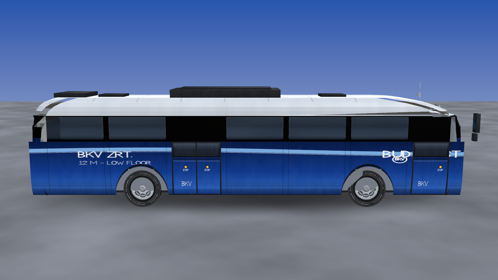

# Budapest (BKV) blue city bus — procedural 3D model

A 12 m low floor city bus in BKV blue livery, the kind Budapest's public
transport operator runs on routes like 5, 7, 8E, 105 and 200E.

**Everything is generated from code**: the mesh is built by JavaScript that
lofts and stitches the geometry, and every texture is painted pixel by pixel by
JavaScript. There are no downloaded models, no image assets and no build step —
`assets/` is produced by the build script from the same source that the viewer
imports.



## Quick start

```bash
# 1. paint the textures and export the mesh (PNG + OBJ/MTL + model.json)
node budapest-bus/tools/build-assets.mjs

# 2. serve the folder and open the viewer in a browser
node budapest-bus/tools/serve.mjs
# -> http://localhost:8080/budapest-bus/
```

The viewer needs no internet connection: three.js is vendored in
`vendor/three/` and loaded through an import map.

## What is in the box

```
budapest-bus/
├── index.html              viewer page (three.js, import map, HUD)
├── src/
│   ├── core/               image rasteriser, PNG writer, vector font
│   │   ├── image.js        Image class: fills, gradients, AA lines/polys, grime
│   │   ├── png.js          minimal PNG encoder (node:zlib)
│   │   └── font.js         hand-built single stroke font (A-Z, 0-9, accents)
│   ├── model/              the mesh
│   │   ├── spec.js         all dimensions, bay/opening layout, plates, display
│   │   ├── builder.js      triangle soup builder: grids, boxes, cylinders, caps
│   │   ├── body.js         lofted shell (blue / black band / glass / roof)
│   │   ├── panels.js       lower side panels + wheel arch cut outs + doors
│   │   ├── wheels.js       tyres, rims, hubs, brake discs
│   │   ├── details.js      bumpers, lamps, grille, mirrors, wipers, roof kit
│   │   ├── interior.js     liner, floor, seats, handrails, driver's cab
│   │   └── index.js        buildBus(): assembles meshes + materials
│   ├── textures/           the paint
│   │   ├── palette.js      BKV palette, world→pixel mapper, roundel, grime
│   │   ├── body.js         both sides, front, rear, roof, door leaves
│   │   ├── surfaces.js     glass, black band, rubber, plastic, metal, interior
│   │   ├── wheels.js       tread, sidewall lettering, rim
│   │   ├── lights.js       head/tail lamps, LED dot matrix displays, plates
│   │   └── index.js        buildTextures()
│   └── viewer/             browser viewer (busObject.js, main.js, hud.js)
├── tools/
│   ├── build-assets.mjs    writes assets/textures/*.png + assets/model/*
│   ├── render-preview.mjs  offline software renderer (no GPU needed)
│   └── serve.mjs           tiny static server
├── tests/                  node smoke tests (geometry, viewer, previewer)
├── preview/                renders produced by the software renderer
├── assets/                 generated output (PNGs, OBJ, MTL, model.json)
└── docs/INTERFACES.md      the frozen contract between model/textures/renderers
```

## The model

| | |
| --- | --- |
| Length / width / height | 12.00 m / 2.55 m / 3.02 m (3.44 m with the roof units) |
| Wheelbase | 6.25 m (front axle +3.35 m, rear axle −2.90 m) |
| Wheels | 1.04 m diameter, front wheels turned slightly |
| Doors | two, on the right hand side only (right hand traffic) |
| Triangles | ~8 500 (26 meshes, 26 materials) |
| Textures | 26 PNGs, 2048×512 down to 256×256, ~4 MB in total |

Details that are modelled rather than painted: wheel arch cut outs with real
wheel wells behind them, door leaves with a proud seal, a fully glazed window
band with black pillars, an interior visible through the tinted glass (liner,
floor, seats, handrails, driver's cab), roof air conditioning unit, hatches,
antenna, front/rear bumpers with number plates, lamp clusters, mirrors, wipers
and the LED destination displays.

## How the mesh is made

The body is **one lofted surface**. A plan view outline (a rounded rectangle
whose half width, front and rear extents and corner radius are all functions of
height, see `src/model/spec.js`) is evaluated at a stack of heights; the quads
between consecutive rings are routed to materials by region — blue paint below
the belt line, black band and glass in the window band, light grey above the
roof edge. The same loft, inset and turned inside out, becomes the interior
liner, which is why the windows read as glazing instead of black holes.

The lower side panels are built separately so they can have **real wheel arch
openings**: the panel is a structured grid whose columns run from the arch
boundary (a superellipse) up to the belt line, plus a ribbon behind the arch
that forms the wheel well. The panels are flat quads with texture coordinates
derived from world position, so the livery never distorts.

## How the textures are painted

`src/core/image.js` is a small software raster image: anti-aliased lines,
polygons, rounded rectangles, ellipses, gradients, noise and grime, all drawn in
*bus coordinates* (metres) through the `mapper()` helper in
`src/textures/palette.js`, so the artwork lines up with the geometry at any
resolution. Text uses `src/core/font.js`, a hand-built single stroke font that
also covers the Hungarian accented letters (Á É Í Ó Ö Ő Ú Ü Ű) seen on the
destination rolls.

The destination displays are drawn as real **dot matrix** panels: the artwork is
rendered first and then sampled on a dot grid, lighting one LED per cell.

## Tools

```bash
node budapest-bus/tools/build-assets.mjs      # textures + OBJ/MTL + model.json
node budapest-bus/tools/render-preview.mjs    # offline renders into preview/
node budapest-bus/tools/render-preview.mjs --selftest
node budapest-bus/tests/geometry.test.mjs     # model sanity checks
node budapest-bus/tests/viewer.smoke.mjs      # viewer module smoke test
node budapest-bus/tools/serve.mjs             # static server for the viewer
```

`render-preview.mjs` is a dependency-free software rasteriser (z-buffer,
perspective correct texturing, alpha blending, simple shading). It exists so the
model can be inspected without a GPU or a browser — the images in `preview/`
are produced by it.

`assets/model/bkv_bus.obj` + `.mtl` can be imported into Blender, and the OBJ
mesh is what the viewer's second mode loads.

## Notes and limitations

* The livery is a plausible BKV scheme (BKV blue, light blue wave, operator
  roundel, Hungarian plates, route 200E towards Kőbánya-Kispest) rather than a
  pixel-exact copy of one particular vehicle.
* The left hand side has no doors, matching continental European (right hand
  traffic) buses.
* Mirror stalks are square section tubes rather than the chrome arms of a real
  Volvo 7900, and there is no engine detail under the rear deck.
* three.js is vendored for the viewer under its MIT licence
  (`vendor/three/LICENSE`); it is used only to display the model, never to build
  it.

